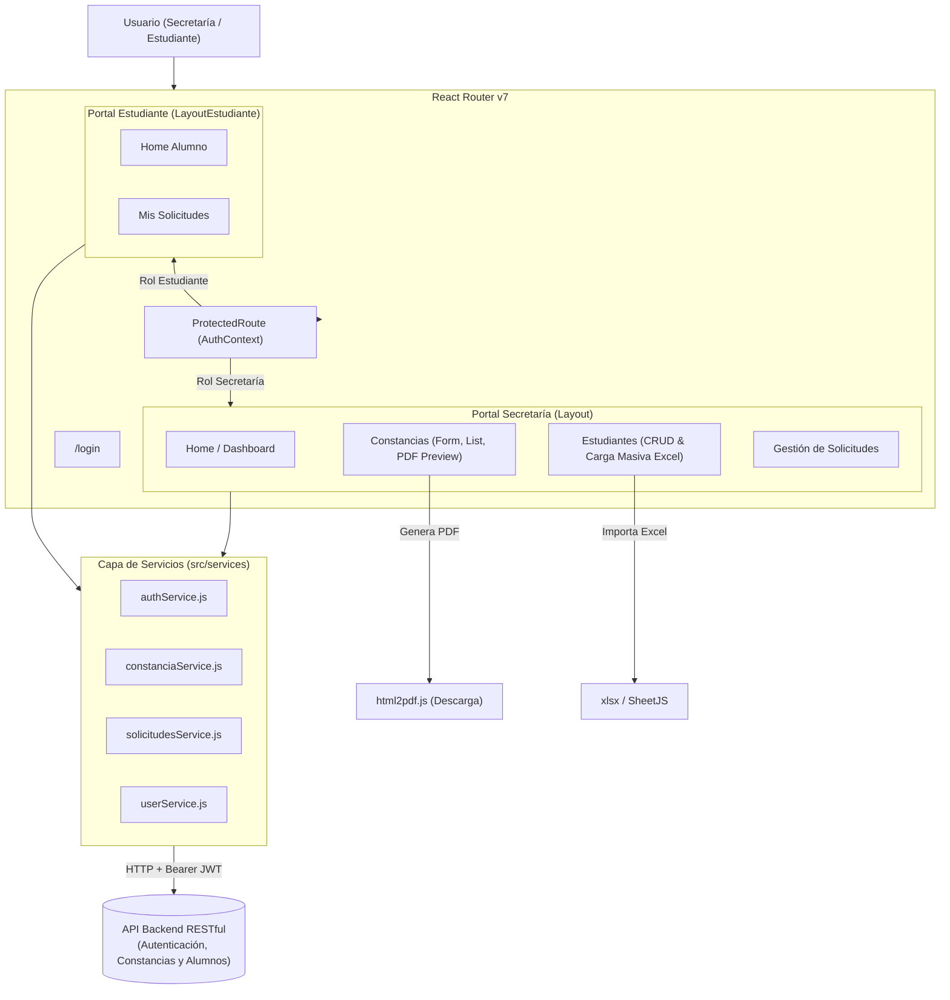

# CertiPro - Sistema Web de Emisión y Gestión de Constancias Académicas

Plataforma web Single Page Application (SPA) desarrollada con **React 19**, **Vite 6** y **TailwindCSS 4** para automatizar el trámite, aprobación, generación interactiva y descarga en PDF de constancias y certificados de estudio para institutos y universidades. Dispone de portales especializados para Secretaría Académica y Estudiantes, integrando importación masiva de alumnos desde archivos Excel.


---

## 1. Funcionalidades Principales

- **Gestión de Trámites por Perfil**: Portal diferenciado para **Secretaría Académica** (revisión, aprobación/rechazo de solicitudes y emisión) y **Estudiantes** (registro de peticiones y consulta del estado de trámite).
- **Emisión y Previsualización de Constancias en PDF**: Generación dinámica y descarga de documentos con formato institucional utilizando `html2pdf.js`.
- **Carga Masiva de Estudiantes**: Procesamiento e importación automatizada de padrones de alumnos a partir de plantillas de hojas de cálculo Excel (`xlsx`).
- **Seguridad en Rutas**: Protección condicional de navegación mediante `ProtectedRoute` y gestión de sesión global con React Context API (`AuthContext`).
- **Feedback Interactivo**: Notificaciones de estado en tiempo real con `react-hot-toast` y componentes visuales accesibles con `@headlessui/react` y `lucide-react`.

---

## 2. Stack Tecnológico

| Tecnología | Rol en el Proyecto |
| :--- | :--- |
| **React 19.1** | Biblioteca base para construcción de interfaces de usuario basadas en componentes funcionales y Hooks. |
| **Vite 6.3** | Entorno de desarrollo rápido y empaquetador para producción con Hot Module Replacement (HMR). |
| **TailwindCSS 4.1** | Framework de diseño basado en utilidades para maquetación responsiva moderna. |
| **React Router DOM 7.6** | Enrutador declarativo para navegación SPA y anidamiento de rutas con layouts. |
| **Context API (AuthContext)** | Gestión centralizada del estado de autenticación, usuario activo y tokens JWT. |
| **xlsx (SheetJS 0.18)** | Parseo, validación y lectura de archivos de hojas de cálculo para importación masiva de datos. |
| **html2pdf.js 0.10** | Conversión de elementos DOM HTML a documentos imprimibles PDF con estilos institucionales. |
| **date-fns 4.1** | Formateo y manipulación de fechas académicas y marcas temporales. |
| **Lucide React / Heroicons** | Iconografía para interfaces operativas y paneles administrativos. |

---

## 3. Arquitectura Frontend

La aplicación utiliza una **Arquitectura Basada en Componentes y Servicios (Component-Driven / Service Layer)**:

- **Context (`src/context/`)**: Provee el estado global de autenticación (`AuthContext`) y expone funciones de inicio/cierre de sesión.
- **Rutas y Guardias (`ProtectedRoute.jsx`)**: Intercepta la navegación y valida la existencia de tokens válidos en `localStorage`.
- **Componentes (`src/components/`)**:
  - `Layout` & `LayoutEstudiante`: Estructuras maestras de navegación con encabezados y menús según rol.
  - Vistas operativas: Constancias, lista de alumnos, importador masivo y solicitudes.
- **Capa de Servicios (`src/services/`)**: Abstrae las llamadas HTTP a la API RESTful mediante `fetch` asíncrono con inyección de cabeceras de autorización Bearer.



---

## 4. Estructura del Proyecto

```text
certipro-frontend/
├── public/                       # Favicon y activos públicos estáticos
├── src/
│   ├── assets/                   # Logotipos institucionales (logoCertipro, vallegrande)
│   ├── components/               # Componentes y vistas principales
│   │   ├── estudiante/           # Vistas exclusivas del alumno (HomeAlumno, Solicitudes)
│   │   ├── BulkUploadStudents.jsx# Carga masiva de alumnos desde archivos Excel (.xlsx)
│   │   ├── ConstanciaForm.jsx    # Formulario para registro y emisión de constancias
│   │   ├── ConstanciaList.jsx    # Listado, filtros y acciones sobre constancias
│   │   ├── ConstanciaPreview.jsx # Renderizado y exportación en PDF institucional
│   │   ├── CreateStudentForm.jsx # Registro individual de estudiantes
│   │   ├── EditStudentForm.jsx   # Actualización de datos de estudiantes
│   │   ├── GestionSolicitudes.jsx# Aprobación y seguimiento de trámites académicos
│   │   ├── Home.jsx              # Tablero principal de secretaría
│   │   ├── Layout.jsx            # Layout administrativo con barra de navegación
│   │   ├── ListaEstudiantes.jsx  # Padrón de estudiantes registrados
│   │   ├── Login.jsx             # Pantalla de acceso al sistema
│   │   └── ProtectedRoute.jsx    # Componente guardián de rutas protegidas
│   ├── context/
│   │   └── AuthContext.jsx       # Proveedor global de autenticación y token
│   ├── hooks/
│   │   └── useNotifications2.js  # Hook personalizado para feedback al usuario
│   ├── services/                 # Llamadas a endpoints de la API REST
│   │   ├── authService.js        # Login, logout y validación de credenciales
│   │   ├── constanciaService.js  # CRUD de constancias y estados
│   │   ├── solicitudesService.js # Aprobación y consulta de trámites
│   │   └── userService.js        # Gestión de usuarios y estudiantes
│   ├── App.jsx                   # Definición de rutas y jerarquía de vistas
│   ├── index.css                 # Estilos globales y utilidades de TailwindCSS
│   └── main.jsx                  # Montaje raíz en el DOM con React 19
├── eslint.config.js              # Reglas de linting y calidad de código
├── index.html                    # Entrada HTML principal de la SPA
├── package.json                  # Dependencias y scripts de Vite
├── vite.config.js                # Configuración de plugins de Vite
└── README.md                     # Documentación técnica del repositorio
```

---

## 5. Seguridad y Gestión de Sesión

1. **Gestión de Tokens JWT**:
   - Tras la autenticación exitosa, el token JWT y los datos del usuario se almacenan en `localStorage`.
   - Los servicios adjuntan automáticamente la cabecera `Authorization: Bearer <token>` en cada consulta a la API.
2. **Rutas Protegidas (`ProtectedRoute.jsx`)**:
   - Evalúa el estado de autenticación en `AuthContext`. Si no existe un token activo, redirige automáticamente al `/login`.
3. **Cierre de Sesión Seguro**:
   - `authService.logout()` limpia los tokens del almacenamiento local y restablece el contexto de React.

---

## 6. Integración con la API Backend

| Módulo / Servicio | Endpoint Backend | Descripción |
| :--- | :--- | :--- |
| `authService` | `POST /api/auth/login` | Inicio de sesión y recepción de token JWT. |
| `authService` | `POST /api/auth/validate` | Verificación de validez de sesión. |
| `constanciaService` | `GET /api/constancias` | Consulta de constancias registradas. |
| `constanciaService` | `POST /api/constancias` | Registro y emisión de nueva constancia. |
| `solicitudesService` | `GET /api/solicitudes` | Lista de solicitudes enviadas por estudiantes. |
| `solicitudesService` | `PUT /api/solicitudes/:id`| Cambio de estado (Aprobada / Rechazada). |
| `userService` | `GET /api/usuarios/estudiantes` | Padrón de alumnos para emisión. |

---

## 7. Cómo Ejecutar Localmente

### Requisitos Previos
- **Node.js**: v18.x o superior (probado en v20+).
- **npm**: v9.x o superior.
- Backend del sistema CertiPro en ejecución o accesible vía red.

### Pasos de Instalación

1. **Clonar el repositorio:**
   ```bash
   git clone https://github.com/LorenzoCampos03/certipro-frontend.git
   cd certipro-frontend
   ```

2. **Instalar dependencias:**
   ```bash
   npm install
   ```

3. **Configurar variables de entorno:**
   - Crear un archivo `.env` en la raíz del proyecto basándose en `.env.example`:
     ```env
     VITE_API_URL=http://localhost:5000/api
     ```

4. **Iniciar el servidor de desarrollo:**
   ```bash
   npm run dev
   ```

5. **Acceder a la aplicación:**
   Abrir en el navegador: [http://localhost:5173](http://localhost:5173)

---

## 8. Pruebas y Calidad de Código

- **Linter**: Verificación estática con ESLint 9:
  ```bash
  npm run lint
  ```
- **Compilación de producción**:
  ```bash
  npm run build
  ```

---

## 9. CI/CD

- **Estado actual**: Sin pipeline de integración continua configurado en el repositorio (roadmap: GitHub Actions para validación de build y lint en cada PR).

---

## 10. Rol y Aportes en el Proyecto

- **Modalidad**: [COMPLETAR: Proyecto en equipo de X personas / Proyecto individual].
- **Responsabilidades asumidas**:
  - Desarrollo de vistas operativas y formularios para Secretaría y Estudiantes.
  - Implementación del sistema de carga masiva de estudiantes a partir de hojas de cálculo Excel (`xlsx`).
  - Maquetación y generación de constancias con renderizado dinámico en PDF con `html2pdf.js`.
  - Integración de servicios asíncronos con la API RESTful e inyección de tokens JWT.
- **Resultados e impacto**:
  - Digitalización del proceso manual de emisión de constancias, reduciendo tiempos de espera de alumnos y secretaría.
  - Soporte para importación de nóminas completas de estudiantes en segundos.

---

## 11. Roadmap / Posibles Mejoras

1. **Centralización de Variables de Entorno**: Externalizar completamente las URLs del backend a variables `import.meta.env.VITE_API_URL` para desacoplar entornos de desarrollo y producción.
2. **Suite de Pruebas Unitarias**: Integrar **Vitest** y **React Testing Library** para pruebas de componentes clave como `BulkUploadStudents` y `ProtectedRoute`.
3. **Migración a TypeScript**: Incorporar tipado estático en modelos y contratos de servicios para mayor robustez en tiempo de compilación.

---

## 12. Contacto

- **Desarrollador**: Lorenzo Campos
- **LinkedIn**: [linkedin.com/in/lorenzo-campos](https://www.linkedin.com/in/lorenzo-campos)
- **Correo Electrónico**: [lorenzo.campos.p@vallegrande.edu.pe](mailto:lorenzo.campos.p@vallegrande.edu.pe)
